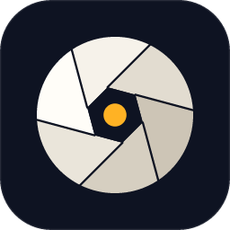

# Photonation

[](https://github.com/DeBlo12/photonation/actions/workflows/ci.yml)
[](LICENSE)

A fast, memory-efficient, non-destructive raw photo editor written in pure Rust —
a Lightroom-style develop module with a Photomator-inspired interface.

- **Raw development** for Bayer cameras (Canon, Nikon, Sony, Panasonic, Olympus/OM,
  Pentax, Leica…), Fujifilm X-Trans and linear DNG (Apple ProRAW), via
  [rawler](https://github.com/dnglab/dnglab).
- **Lightroom's light and colour tools**: white balance (presets, eyedropper,
  temperature/tint), exposure, contrast, highlights, shadows, whites, blacks,
  texture, clarity, dehaze, vibrance, saturation, parametric and point tone curves
  (RGB and per channel), an 8-band colour mixer, point colours (pick a colour in
  the photo and shift its hue, saturation and luminance), colour grading wheels
  (shadows/midtones/highlights/global with blending and balance), sharpening,
  luminance and colour noise reduction, lens corrections (distortion,
  vignetting and chromatic aberration from the bundled Lensfun database).
- **Local edits and geometry**: masks (linear and radial gradients and a brush
  combined per mask, with local adjustments), crop and straighten (draw a level line, or let
  Auto find it), and object removal by content-aware fill or a neural inpainting
  model, with people selected in one click. Models are separate downloads that
  run on your computer only.
- **Culling and presets**: star ratings, pick and reject flags, colour labels,
  filter and sort, grid and survey views; presets and copying settings between
  photos. Lightroom edits (from XMP) and `.xmp` presets import.
- **Viewing**: zoom, compare with the original, and a true full screen with the
  photo alone (⌃F on a Mac, `F` elsewhere).
- **Non-destructive**: originals are never touched; edits live in a JSON sidecar
  next to each photo (`IMG_0001.CR3.photonation.json`), with undo/redo.
- **Fast and lean**: a band-parallel pipeline renders a 24 MP raw to full-size
  JPEG in ~170 ms (Apple M1 Pro) without ever holding a full-size float image;
  slider drags re-render the preview in ~40 ms.
- **Export** to JPEG, PNG (8/16-bit) and TIFF (8/16-bit) in sRGB, Display P3,
  Adobe RGB or ProPhoto RGB with embedded ICC profiles and EXIF/XMP metadata
  (camera, lens, capture time, creator and copyright; GPS only if chosen).
- **Desktop app** (macOS first; egui, so the same UI can later run in the browser
  via WebAssembly) and a **CLI** for batch export. The app follows the system
  between light and dark, or stays in the one chosen in Settings. On macOS it
  uses the system menu bar, and on macOS 26 and later the window is Liquid Glass.

> Status: early. The core pipeline, CLI and desktop editor work; see
> [docs/ROADMAP.md](docs/ROADMAP.md) for what's next.

## Quick start

There are no prebuilt downloads yet, so Photonation is built from source.

Requires Rust 1.95+ (the pinned toolchain in `rust-toolchain.toml` installs
automatically with rustup). On macOS the Xcode licence must be accepted
once (`sudo xcodebuild -license`).

```bash
cargo run --release -p photonation-desktop -- ~/Pictures/Raw
```

Opens the editor on a folder (or pass a single raw file to open it directly).
In the app, **Open** chooses a folder or a single photo.
A folder that holds only folders shows an overview of the ones with raw photos.

```bash
cargo run --release -p photonation-cli -- export ~/Pictures/Raw -o ~/Pictures/Export --long-edge 2048
```

Batch-exports every raw in a folder, applying each photo's sidecar edits.

### macOS

Build a disk image (`photonation-<version>-macos-<architecture>.dmg`) with
`packaging/macos/build-installer.sh`; see
[DEVELOPMENT.md](docs/DEVELOPMENT.md#macos-installer). Open it and drag
Photonation to Applications. Until releases are notarized, macOS blocks the
first launch of a downloaded copy: try to open the app, then choose
**Open Anyway** in System Settings ▸ Privacy & Security.

### Windows

Build an installer (`photonation-<version>-windows-x64-setup.exe`) for
Windows 10/11 with
`packaging\windows\build-installer.ps1`; see
[DEVELOPMENT.md](docs/DEVELOPMENT.md#windows-installer). It installs the
editor (Start menu: Photonation) and, optionally, puts the `photonation` CLI
on `PATH`. Shortcuts use Ctrl where the table below shows ⌘, and Alt for ⌥.

### CLI

| Command | What it does |
|---|---|
| `photonation info <files…>` | Camera, lens, exposure, size, as-shot white balance |
| `photonation export <files or folders…>` | Develop and write JPEG/PNG/TIFF (`--format`, `--quality`, `--long-edge`, `--color-space`, `--depth`, `--metadata all\|copyright\|none`, `--location`, `--creator`, `--copyright`, slider overrides such as `--exposure 0.5 --shadows 30`) |
| `photonation edit <files…> --exposure 0.3 …` | Create or update sidecars without exporting |

### Desktop shortcuts

| Key | Action |
|---|---|
| ⌘O | Open folder |
| ⇧⌘O | Open photo |
| ← / → | Previous / next photo |
| ⌘Z / ⇧⌘Z | Undo / redo |
| `\` | Compare with original (drag the divider) |
| ⌃F (`F` on Windows and Linux) | Full screen, the photo alone (the same key or `Esc` leaves) |
| `M` / `R` / `Q` | Masks / crop and straighten / remove objects |
| `[` / `]` | With a mask brush: smaller / larger brush |
| ⌘0, double-click | Fit / actual pixels |
| ⇧⌘E | Export |
| ⌘, | Settings |
| Double-click a slider | Reset it; hold ⌥ while dragging for fine control |

## Documentation

| Document | Contents |
|---|---|
| [ARCHITECTURE.md](docs/ARCHITECTURE.md) | Crates, layers, data model, key decisions |
| [PIPELINE.md](docs/PIPELINE.md) | The render path step by step: band engine, demosaic, colour, tone |
| [EDIT-MODEL.md](docs/EDIT-MODEL.md) | Settings, controls, sidecars, process versions |
| [ENGINE.md](docs/ENGINE.md) | Background workers, events, export |
| [RETOUCH.md](docs/RETOUCH.md) | Object removal: fills, models, caching |
| [DESKTOP.md](docs/DESKTOP.md) | The editor's layout and per-frame control flow |
| [DEVELOPMENT.md](docs/DEVELOPMENT.md) | Building, testing, conventions, adding a control |
| [ROADMAP.md](docs/ROADMAP.md) | What's done and what's next |

## Contributing

Contributions are welcome — see [CONTRIBUTING.md](CONTRIBUTING.md) and the
[Code of Conduct](CODE_OF_CONDUCT.md). Report security issues privately as
described in [SECURITY.md](SECURITY.md).

## License

Photonation is free software, licensed under the
[GNU General Public License v3.0 or later](LICENSE). You may use, study, share
and modify it; distributed copies and derivatives must stay under the GPL with
their source available. It comes with no warranty, to the extent permitted by
law; see sections 15 and 16 of the licence. Third-party components and their licences are listed in
[NOTICE](NOTICE).
